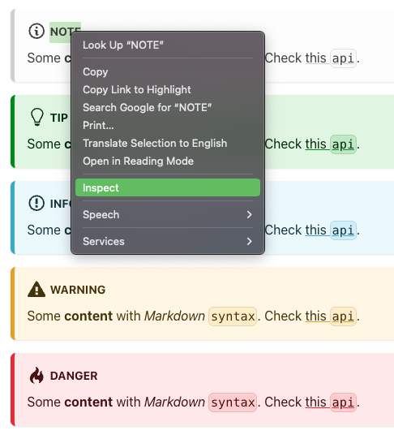
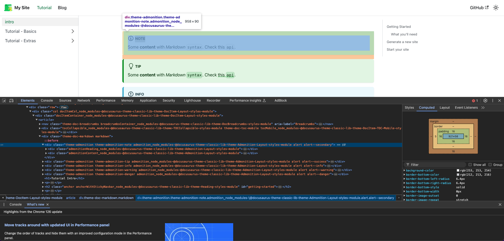
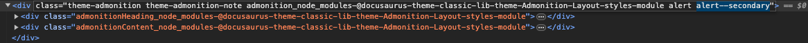
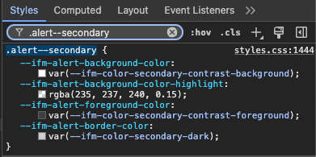
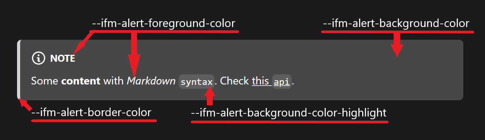
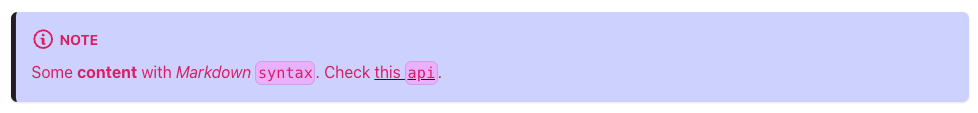
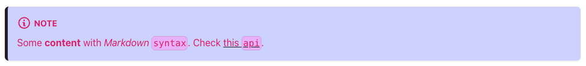

This guide changes the appearance of built-in Docusaurus admonitions. To add a new admonition
type instead, see [Admonitions](/knowledge/component-library/existing/Admonitions/).

## Before you start

For the admonition syntax and available types, see the Docusaurus documentation.

<DocusaurusButton
  label="Docusaurus Documentation: Admonitions"
  to="https://docusaurus.io/docs/markdown-features/admonitions"
/>

To understand how admonitions work, we need to utilize Inspect Element to find things such
as HTML class names and CSS values that the admonitions use.

### Using Inspect Element

In Chrome, right-click an admonition title and select "Inspect" to open the browser's developer
tools.

:::tip

You can change CSS values in the Styles panel to preview them. These changes are temporary.

:::



The Elements panel shows the page HTML. This guide focuses on the admonition markup.

## Analyzing the HTML (Using Inspect)

When clicking inspect on your site, you may find something like this:



This is the HTML Docusaurus generates for the page. The highlighted note admonition is a `<div>`
with several classes.



The `alert--secondary` class controls the note admonition's colours. In the Styles panel, search
for this class to find the variables it uses.

## Analyzing the CSS (Using Inspect)



This is the note admonitions CSS code. This is what tells the note admonition what
colors to use. We see four attributes and their corresponding default variables:

### Default CSS values for the note admonition

| CSS Attribute                            | Default Value                                    |
| ---------------------------------------- | ------------------------------------------------ |
| `--ifm-alert-background-color`           | `var(--ifm-color-secondary-contrast-background)` |
| `--ifm-alert-background-color-highlight` | `rgba(235, 237, 240, 0.15)`                      |
| `--ifm-alert-foreground-color`           | `var(--ifm-color-secondary-contrast-foreground)` |
| `--ifm-alert-border-color`               | `var(--ifm-color-secondary-dark)`                |



To preview a different background, change `--ifm-alert-background-color` in the Styles panel.
For example, set it to purple and the note updates immediately.

:::warning

Changes made in the developer tools are temporary. Refresh the page to discard them.

:::


## Updating the CSS

To keep the changes, add the overrides to your site's CSS.

Open `src/css/custom.css` in your Docusaurus project.

Add an override for the `alert--secondary` (note) class:

```css title="src/css/custom.css"
.alert--secondary {
  --ifm-alert-background-color: rgb(237, 219, 255);
  --ifm-alert-background-color-highlight: rgb(235, 237, 240);
  --ifm-alert-foreground-color: var(--ifm-color-secondary-contrast-foreground);
  --ifm-alert-border-color: var(--ifm-color-secondary-dark);
}
```

These values change the note's background, highlight, text, and border colours:

```css title="src/css/custom.css"
.alert--secondary {
  --ifm-alert-background-color: rgb(210, 216, 255);
  --ifm-alert-background-color-highlight: rgb(233, 187, 255);
  --ifm-alert-foreground-color: rgb(216, 36, 111);
  --ifm-alert-border-color: rgb(38, 31, 41);
}
```



:::tip

You can use hexadecimal colour values instead:

```css title="src/css/custom.css"
.alert--secondary {
  --ifm-alert-background-color: #d2d8ff;
  --ifm-alert-background-color-highlight: #e9bbff;
  --ifm-alert-foreground-color: #d8246f;
  --ifm-alert-border-color: #261f29;
}
```

:::

## ⭐️ Admonition Class Names

Here are the names of all the default admonition classes:

| Admonition | Class Name         |
| ---------- | ------------------ |
| Note       | `alert--secondary` |
| Tip        | `alert--success`   |
| Info       | `alert--info`      |
| Warning    | `alert--warning`   |
| Danger     | `alert--danger`    |

Use these class names to override the other admonition styles in `custom.css`.

## Making Color-Responsive Admonitions

Colours that work in light mode may not work in dark mode. Use theme-specific CSS variables to
set values for each mode.

### Make a Custom CSS Variable

Define a CSS variable for each colour you want to customise.

In your `custom.css`, Docusaurus comes with a `:root` and a `[data-theme='dark']` config by
default. You can name your variable anything you would like, just make sure it is descriptive
and fits your needs!

:::note

It is recommended you add a new config: `[data-theme='light']`, although, it is not
required, and all light mode variables can be put inside of `:root`. The guide will continue with
creating the new config for the light theme.

:::

```css css title="src/css/custom.css"
[data-theme='light'] {
  --note-bg: rgb(210, 216, 255);
}
```

### Apply Custom CSS Variable

Now that we created our new color variable `--note-bg`, we have to apply it to the `alert--secondary`
CSS class. Update the static RGB value of `.alert--secondary` to our new variable, using `var()`.

```css title="src/css/custom.css"
.alert--secondary {
  // highlight-next-line
  --ifm-alert-background-color: var(--note-bg);
  --ifm-alert-background-color-highlight: rgb(233, 187, 255);
  --ifm-alert-foreground-color: rgb(216, 36, 111);
  --ifm-alert-border-color: rgb(38, 31, 41);
}
```

Now, let's add a color for when the page is in dark mode. The procedure is very similar to the
previous steps, excpt we are adding a new variable to the dark mode config!

```css title="src/css/custom.css"
[data-theme='light'] {
  --note-bg: rgb(210, 216, 255);
}

[data-theme='dark'] {
  --note-bg: rgb(83, 73, 126);
  // ...
}
```

Let's go ahead and set the colors of all our other parts of the note admonition. Here's an
example:

```css title="src/css/custom.css"
[data-theme='light'] {
  --note-bg: rgb(210, 216, 255);
  --note-highlight: rgb(233, 187, 255);
  --note-foreground: rgb(216, 36, 111);
  --note-border: rgb(38, 31, 41);
}

[data-theme='dark'] {
  --note-bg: rgb(83, 73, 126);
  --note-highlight: rgb(68, 58, 72);
  --note-foreground: rgb(255, 255, 255);
  --note-border: rgb(226, 158, 255);
  // ...
}

.alert--secondary {
  --ifm-alert-background-color: var(--note-bg);
  --ifm-alert-background-color-highlight: var(--note-highlight);
  --ifm-alert-foreground-color: var(--note-foreground);
  --ifm-alert-border-color: var(--note-border);
}
```

### Results

Now we can observe that the colors of our "note" admonition change between light mode and dark
mode!




## Conclusion

Congratulations! You are now a pro at overriding the basic colors of the "note" admonition!
Using your knowledge, you should be able to override the colors of all the default admonitions using
the [class names](#%EF%B8%8F-admonition-class-names) listed above!

:::tip

Use your new HTML and CSS knowledge to see what other elements of the webpage you can edit! Find
their class names, and tinker with them in your `custom.css` file, just like how you did with the
"note" admonition!

:::
